# 阿B听书 · iOS 安装指南（Sideloadly 自签）

本文介绍如何把阿B听书的 IPA 安装包安装到 iPhone 上，以 Windows + **Sideloadly** 自签方式为例。全文步骤均在 iPhone XR（iOS 17）上实测通过。

## 为什么不能像 Android 一样直接装

苹果要求所有安装到 iPhone 的应用都必须有有效签名。阿B听书的 IPA 是**未签名包**（签名证书和每个人的 Apple ID 绑定，无法预先签好分发），所以需要在电脑上用你自己的 Apple ID 现场签名后安装——这个过程叫「自签侧载」。

- ✅ 手机**不需要登录任何 Apple ID**，签名在电脑端完成
- ✅ 免费 Apple ID 即可，无需付费开发者账号
- ✅ 装好的 App 完全本地运行，不依赖任何账号体系
- ⚠️ 免费 Apple ID 的签名 **7 天过期**，到期重签一次即可；付费开发者账号（$99/年）有效期 1 年

## 准备工作

| 需要什么 | 说明 |
| --- | --- |
| Windows 电脑 | macOS 用户可用 AltStore，流程类似 |
| 数据线 + iPhone | iOS 15.0+（阿B听书 iOS 版最低版本） |
| Apple ID | 任意正常状态的个人账号，知道密码；开了双重认证的要能收到验证码 |
| Sideloadly | 官网下载：<https://sideloadly.io> |
| Apple 设备驱动 | 见下方「常见问题」第 1 条，装过完整 iTunes 的可跳过 |
| 未签名 IPA | 从 [Releases](../../releases) 下载 `abts-unsigned.ipa` |

## 安装步骤

### 1. 连接手机到电脑

数据线连接 iPhone，解锁手机，若弹出「**信任此电脑**」→ 点信任并输入锁屏密码。

### 2. 打开 Sideloadly，填入信息

- **iDevice**：下拉框选择你的 iPhone（识别不到看文末常见问题）
- **Apple ID**：填完整的邮箱格式账号（如 `xxx@icloud.com`；手机号注册的 Apple ID 请到 appleid.apple.com 查看登录邮箱）
- 把 IPA 文件**拖进窗口**

### 3. 开始签名安装

点 **Start**：

- 若开启双重认证：手机会弹出六位验证码，把它**直接连在密码后面输入**（如 `密码492013`，中间不要空格）
- 等待进度走完（下载证书 → 签名 → 上传安装），期间保持解锁、别拔线

### 4. 打开开发者模式（iOS 16+）

> 开发者模式开关**只有在第一次成功装上签名 App 后才会出现**，装之前找不到是正常的。

安装成功后通常自动弹出提示，跟着重启确认即可；没弹的话：**设置 → 隐私与安全性 → 开发者模式** → 打开 → 重启手机。

### 5. 信任开发者证书

首次打开 App 若提示「不受信任的开发者」：**设置 → 通用 → VPN与设备管理** → 找到你的 Apple ID 开发者证书 → 点信任。

完成后回到桌面，就能看到阿B听书的图标了。

## 安装成功后的样子

**桌面图标**：

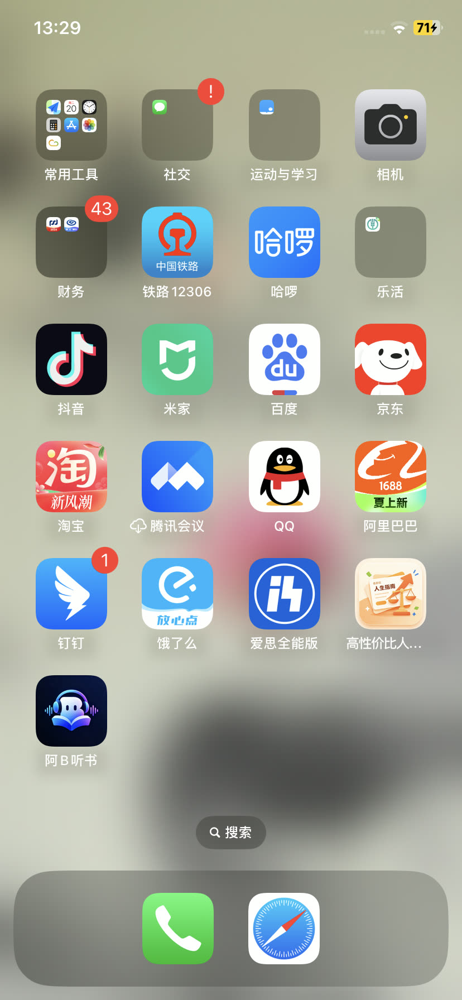

**发现与搜索**（免登录即可搜索、收听全部内容）：

| 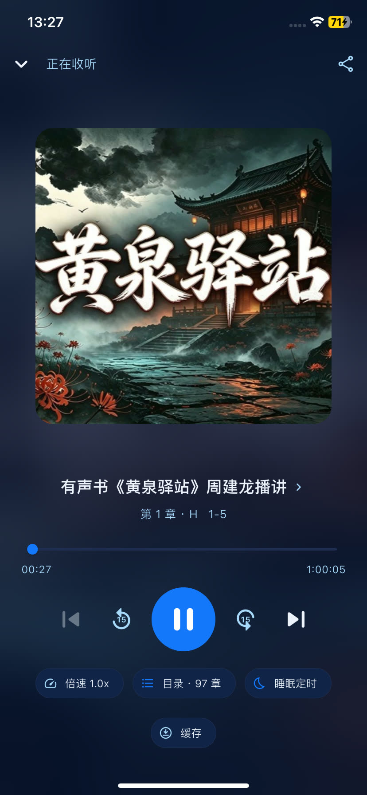 | 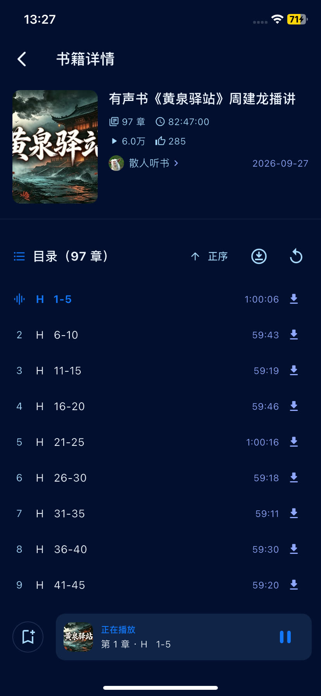 |
| --- | --- |
| 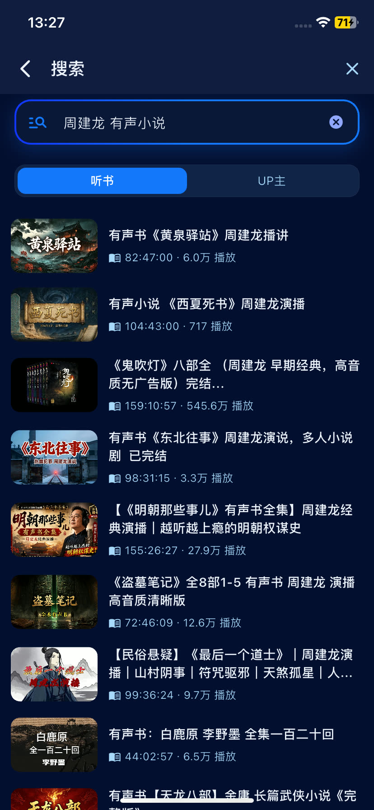 | 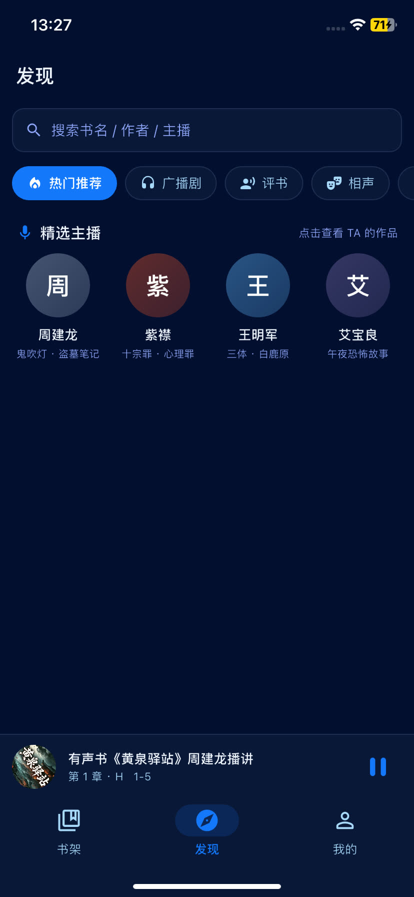 |

**书架与个人中心**（断点续播、离线缓存、睡眠定时都在）：

| 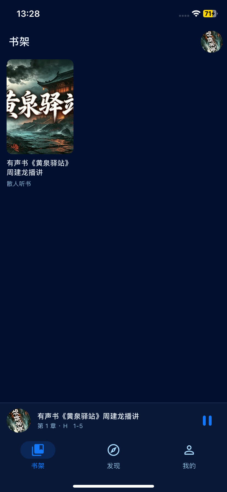 | 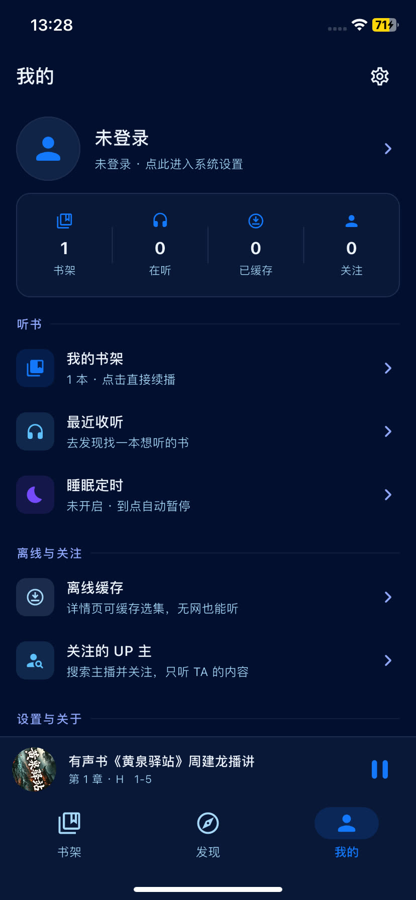 |
| --- | --- |
| 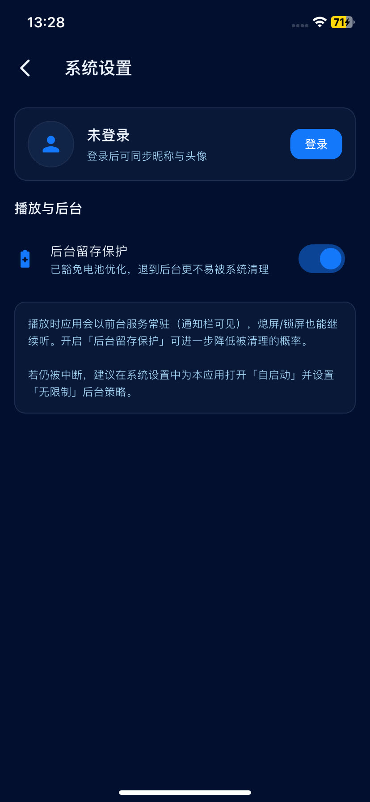 | 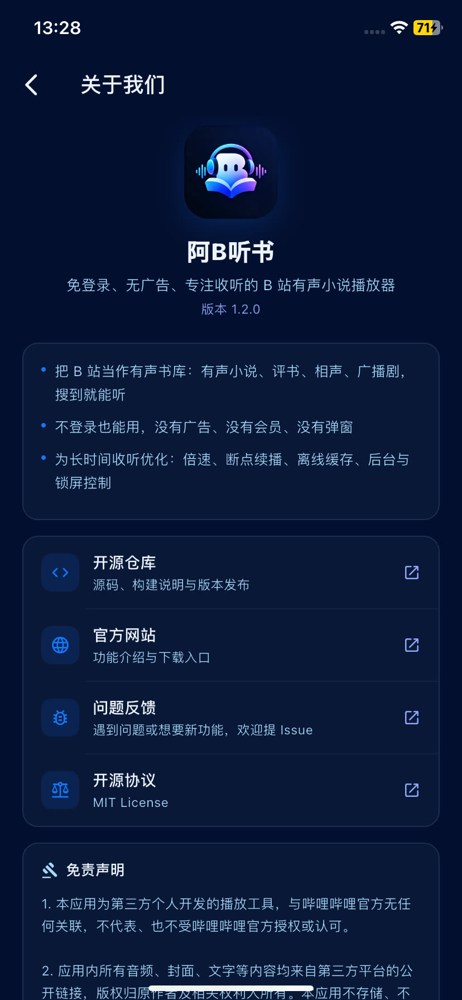 |

**锁屏播放控制**——锁屏也能看进度、±15 秒快进退、暂停：

| 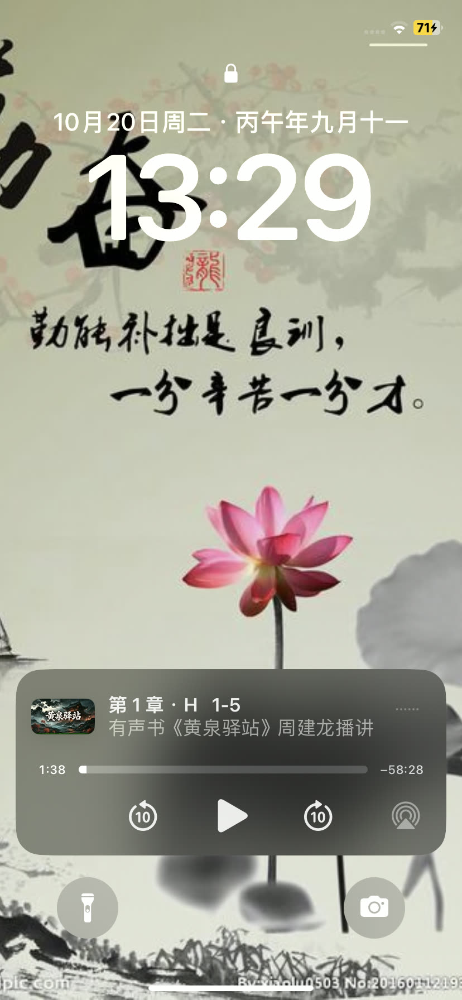 | 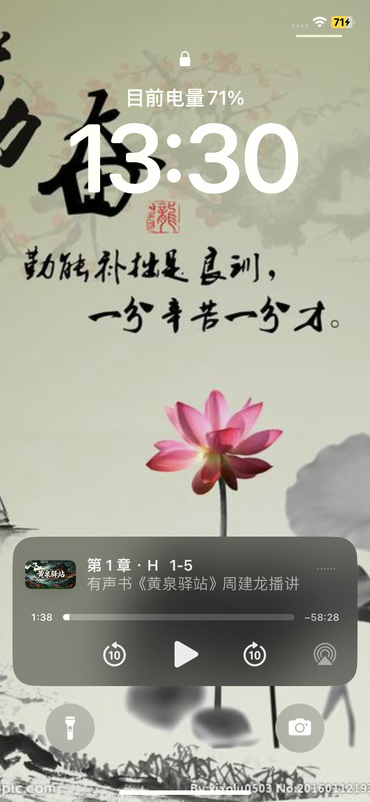 |

## 常见问题（实测踩坑记录）

### 1. Sideloadly 识别不到设备

绝大多数情况是电脑缺少 **Apple 移动设备驱动**（USB 驱动正常但服务缺失）。两种解决方式：

- 安装完整版 [iTunes](https://www.apple.com/itunes/download/win64)（自带驱动）；
- 或只装驱动组件：用 7-Zip 打开 iTunes 安装包，解压出 `AppleMobileDeviceSupport64.msi`（约 34 MB）直接安装，无需装完整 iTunes。

装完后**完全退出并重开 Sideloadly**，拔插一次数据线。

### 2. 报错 `0xe800801c No code signature found`

**Sideloadly 的 Apple ID 栏没填**。留空时它会跳过签名直接安装，未签名包会被手机拒绝。填上 Apple ID 重新 Start。

### 3. 报错 `Login failed: 404`

苹果登录接口验证失败，按顺序排查：

- Apple ID 是否填了**完整邮箱**（手机号注册的 ID 直接填手机号会 404）
- 隔一两分钟重试（接口临时波动）
- Sideloadly 设置里**更换 Anisette 服务器**
- 临时关闭电脑上的代理/加速器
- 升级到最新版 Sideloadly

### 4. 报错 `-20209`

Apple ID 因安全原因被锁定（多次尝试登录触发风控）。到 <https://iforgot.apple.com> 解锁，或**换一个 Apple ID** 签名——免费证书用哪个 ID 都可以。

### 5. 报错 `0xe8008018`（签名身份已失效）

- 签名用的 Apple ID 在安装过程中被锁/证书被吊销 → 换正常状态的 ID 重签
- 检查电脑和手机的**时间是否自动同步**
- 删除手机上残留的半安装图标后重试
- 免费 Apple ID **7 天内最多签 10 个 App ID**，超了会吊销最早的证书，换号或次日再签

### 6. 签名 7 天过期了

App 打不开或提示证书过期时，用 Sideloadly + 同一个 Apple ID 把 IPA 重装一次即可覆盖续期，书架和播放进度不受影响。

> 免费 Apple ID 限制：同时最多 3 个 App ID、7 天内最多 10 个签名。只想维持阿B听书的话完全够用。

## 备选方案

| 方式 | 适用情况 |
| --- | --- |
| **爱思助手**（自签安装） | 国内用户最省事：对手机号 Apple ID、双重认证的兼容性比 Sideloadly 好，走网页授权登录 |
| **AltStore** | Sideloadly 抽风时的备胎，且支持手机端自助续签（需电脑和手机同一 Wi-Fi） |
| **TestFlight** | 需要开发者付费账号分发，暂未提供 |

---

*本文安装流程在 iPhone XR / iOS 17.6 实测通过；文中截图均来自实机。*
